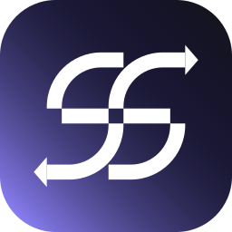

<div align="center">



# ShareSwitch

**Switch the window you're sharing in video calls — without stopping the share.**

Share one window in Teams / Zoom / Meet, then flip what it shows with a hotkey + click.
No "Stop sharing → Share again" dance. No "can you see my screen now?"

<!-- DESIGNER: hero demo GIF goes here (see docs/LAUNCH.md) -->
<!--  -->

[](https://github.com/alexisdc06/ShareSwitch/actions)
[](https://github.com/alexisdc06/ShareSwitch/releases/latest)
[](LICENSE)

</div>

## How it works

ShareSwitch opens one **proxy window** that mirrors any other window live. You share the proxy in your call once. From then on:

1. **Hold `Ctrl + Alt`** — the window under your mouse gets a highlight frame
2. **Left-click** — the proxy instantly mirrors that window instead, and the frame fades away
3. Release. Your viewers never noticed a transition.

Prefer a list? Right-click the tray icon → **Select Window…**

The proxy window resizes itself to match whatever it's mirroring, so viewers never see letterbox bars. Its title bar and border are tinted blue so you can always tell it apart from the real app — and on Windows 11 that tint lives in the window chrome, which screen-sharing doesn't capture, so your viewers only see clean content.

The mirror is powered by the Windows compositor (DWM thumbnails): pixel-perfect, live, and essentially zero CPU overhead.

## Install

**[⬇ Download the latest release](https://github.com/alexisdc06/ShareSwitch/releases/latest)**

- `ShareSwitch-Setup-x.y.z.exe` — installer (Start menu shortcut, optional autostart, uninstaller)
- `ShareSwitch-x.y.z-portable.exe` — single portable exe, no install needed

Requires Windows 10/11 (x64). No runtime to install — everything is self-contained.

> **SmartScreen note:** the binaries aren't code-signed yet, so Windows may show
> "Windows protected your PC" → click *More info* → *Run anyway*. You can also
> build from source (below).

ShareSwitch is in early testing — [feedback and bug reports](https://github.com/alexisdc06/ShareSwitch/issues) are very welcome. See [CHANGELOG.md](CHANGELOG.md) for what's new.

## Usage tips

- Change the hotkey combo: tray icon → **Selection Hotkey** (AZERTY users: Ctrl+Alt is AltGr — a short hold-delay prevents accidental triggers while typing, or just pick another combo).
- **Esc** or releasing the keys cancels selection; the selecting click never reaches the app you clicked.
- Closing the ShareSwitch window only hides it (your share stays alive). Quit from the tray.

## Limitations

- The mouse cursor isn't shown in the mirror (DWM limitation).
- Protected windows (DRM video, some banking apps) and a few UWP apps can't be mirrored.
- Minimized source windows freeze until restored.

## Privacy & security

ShareSwitch has **no networking code whatsoever** — no telemetry, no analytics, no update checks. Nothing leaves your machine.

It does install a global keyboard hook (that's how it sees the hotkey while another app has focus), so here's the honest detail: every key that isn't **Ctrl, Alt, Shift or Escape** is discarded inside the hook callback before any other code sees it. Nothing is stored or transmitted. The mouse hook only exists while you hold the combo. No admin rights required.

Full explanation, threat model, and how to report a vulnerability: **[SECURITY.md](SECURITY.md)**

## Build from source

```
git clone https://github.com/alexisdc06/ShareSwitch
cd ShareSwitch
dotnet build            # or open ShareSwitch.sln in Visual Studio 2022
.\publish.ps1           # distributable exe + installer
```

.NET 8 SDK required. Architecture and design notes: [docs/DEVELOPMENT.md](docs/DEVELOPMENT.md) · Test protocol: [TESTING.md](TESTING.md)

## License

[MIT](LICENSE) © 2026 [AC Design Studio](https://ac-design.studio)
